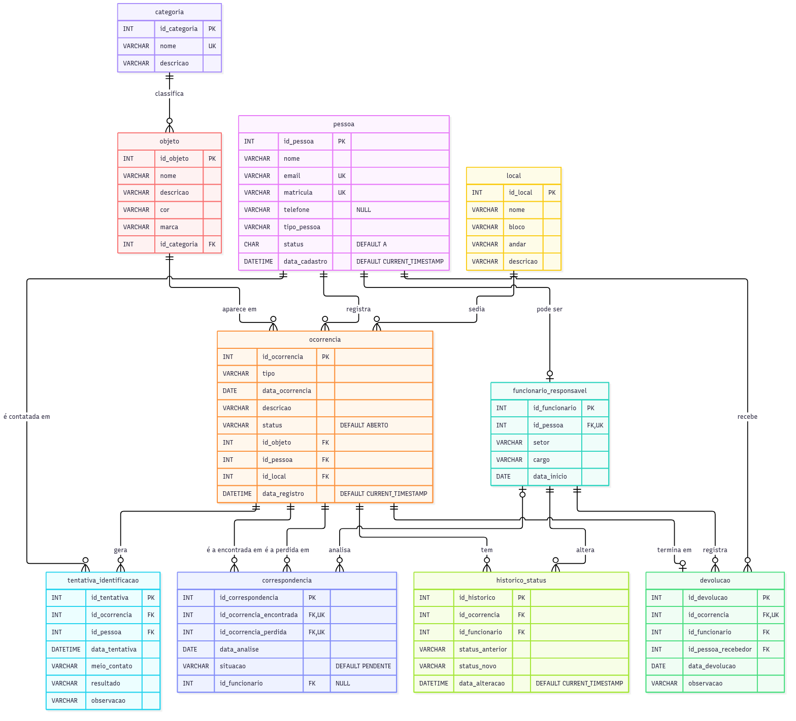

# EncontraAFYA

Sistema universitário de achados e perdidos, modelado e implementado em **MySQL 8.0** como projeto final da disciplina de Banco de Dados.

O banco organiza o processo do registro até a devolução: objetos perdidos e encontrados, comparação entre os registros, tentativas de localizar o dono, devolução e histórico de cada mudança de status.

## Integrantes

- Ciça Lima
- Pedro Douglas
- Luis Felipe Romão

**AFYA Centro Universitário**: Engenharia da Computação, Banco de Dados, 2º semestre de 2026.

## O projeto em números

| Item | Quantidade |
|---|---|
| Tabelas | 10, em Terceira Forma Normal |
| Relacionamentos | 2 do tipo 1:1, 6 do tipo 1:N e 3 do tipo N:N |
| Restrições | 15 FKs, 11 CHECK, 6 UNIQUE e 6 DEFAULT |
| Registros | 334, com pelo menos 15 por tabela |
| Consultas | 13: 6 simples, 5 com JOIN, 1 com LEFT JOIN e 1 com subconsulta |
| Trigger | 1, para uma regra que o CHECK não consegue verificar |

## Estrutura do repositório

```text
encontra-afya/
├── README.md
├── Projeto_Final_Banco_de_Dados(3).docx   enunciado do projeto
├── docs/
│   ├── relatorio.md                       relatório técnico completo
│   ├── proposta.md                        domínio, regras de negócio e decisões de modelagem
│   ├── dicionario_dados.md                tabelas, colunas, tipos e restrições
│   ├── der.png                            diagrama entidade-relacionamento
│   └── der.mmd                            código-fonte do diagrama (Mermaid)
└── sql/
    ├── encontraafya.sql                   criação do banco, das tabelas e dos dados
    ├── consultas.sql                      as 13 consultas comentadas
    └── auxiliares.sql                     trigger e conferência da carga
```

## Como executar

O banco roda em um contêiner Docker com a imagem oficial do MySQL, sem precisar instalar o MySQL no sistema. Os comandos abaixo devem ser executados na pasta do projeto.

```bash
# 1. Baixar a imagem e subir o MySQL
docker pull mysql:8.0
docker run -d --name encontraafya-mysql -e MYSQL_ROOT_PASSWORD=afya2026 mysql:8.0

# 2. Aguardar até a resposta "mysqld is alive"
docker exec encontraafya-mysql mysqladmin ping -h127.0.0.1 -uroot -pafya2026

# 3. Criar o banco, inserir os dados e criar o trigger
docker exec -i encontraafya-mysql mysql -uroot -pafya2026 --default-character-set=utf8mb4 < sql/encontraafya.sql
docker exec -i encontraafya-mysql mysql -uroot -pafya2026 --default-character-set=utf8mb4 -t < sql/auxiliares.sql

# 4. Abrir o MySQL e executar as consultas de sql/consultas.sql
docker exec -it encontraafya-mysql mysql -uroot -pafya2026 --default-character-set=utf8mb4 encontraafya
```

Para recomeçar do zero, use `docker rm -f encontraafya-mysql` e repita os passos.

O passo a passo detalhado, a execução sem Docker e a explicação de cada comando estão na [seção 7 do relatório](docs/relatorio.md#7-instruções-de-execução).

## Documentação

- [Relatório técnico](docs/relatorio.md): resumo, regras de negócio, DER, dicionário de dados, normalização, catálogo de consultas com saídas e considerações finais.
- [Proposta do projeto](docs/proposta.md)
- [Dicionário de dados](docs/dicionario_dados.md)
- [Diagrama entidade-relacionamento](docs/der.png)


