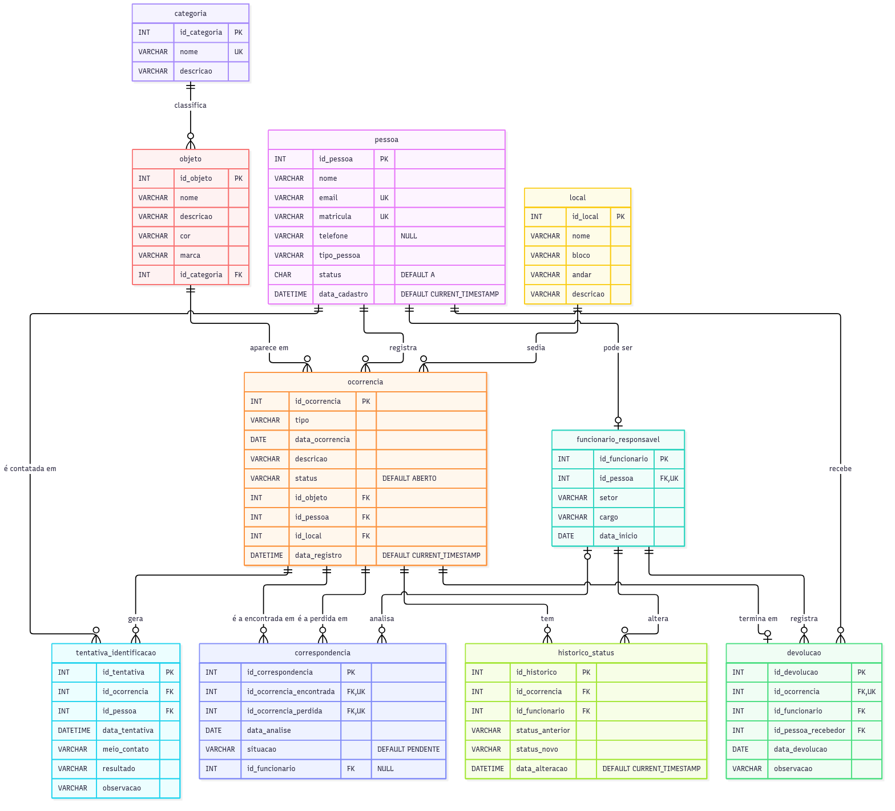

# EncontraAFYA: Sistema Universitário de Achados e Perdidos

**Relatório técnico do Projeto Final de Banco de Dados**

| | |
|---|---|
| **Instituição** | AFYA Centro Universitário |
| **Curso** | Engenharia da Computação |
| **Disciplina** | Banco de Dados |
| **Semestre** | 2º semestre de 2026 |
| **Integrantes** | Ciça Lima, Pedro Douglas e Luis Felipe Romão |
| **Repositório** | https://github.com/pedroqueirozs/encontra-afya |
| **Apresentação** | 16 de novembro de 2026 |

## Sumário

1. [Resumo executivo](#1-resumo-executivo)
2. [Domínio e regras de negócio](#2-domínio-e-regras-de-negócio)
3. [Diagrama entidade-relacionamento](#3-diagrama-entidade-relacionamento)
4. [Dicionário de dados](#4-dicionário-de-dados)
5. [Justificativa da normalização](#5-justificativa-da-normalização)
6. [Catálogo de consultas](#6-catálogo-de-consultas)
7. [Instruções de execução](#7-instruções-de-execução)
8. [Considerações finais](#8-considerações-finais)
9. [Referências](#9-referências)

## 1. Resumo executivo

O EncontraAFYA é um banco de dados relacional, implementado em MySQL 8.0, que organiza o processo de achados e perdidos de um campus universitário. Ele registra os objetos perdidos e encontrados, compara os registros entre si, acompanha as tentativas de localizar o dono, documenta a devolução e guarda o histórico de cada mudança de status. O esquema tem 10 tabelas em Terceira Forma Normal, com relacionamentos 1:1, 1:N e N:N, e usa chaves primárias, chaves estrangeiras com ações referenciais explícitas, NOT NULL, UNIQUE, CHECK e DEFAULT para garantir as regras de negócio.

O banco foi povoado com dados coerentes do 2º semestre de 2026: 60 pessoas, 50 ocorrências, 17 devoluções e um total de 334 registros nas 10 tabelas. Sobre essa base, 13 consultas respondem a perguntas reais do atendimento, como quais objetos ainda aguardam o dono ou quais setores devolvem mais rápido. Um trigger complementa as restrições, garantindo uma regra que o CHECK do MySQL não consegue verificar. Todo o ambiente roda em um contêiner Docker com a imagem oficial do MySQL.

## 2. Domínio e regras de negócio

Em um campus universitário, alunos, professores e funcionários circulam por salas, laboratórios, biblioteca, cantina e estacionamento, e objetos são perdidos e encontrados com frequência. Sem um registro organizado, quem perdeu não sabe se o objeto foi achado, e quem achou não sabe a quem devolvê-lo. O EncontraAFYA organiza esse processo do registro até a devolução.

### 2.1 Funcionamento do processo

1. Uma pessoa cadastrada informa que perdeu ou encontrou um objeto. Isso gera uma **ocorrência** do tipo PERDIDO ou ENCONTRADO, com status inicial ABERTO.
2. Um funcionário responsável analisa a ocorrência, que passa a EM_ANALISE. Cada mudança de status fica guardada no histórico.
3. O funcionário compara ocorrências de ENCONTRADO com ocorrências de PERDIDO. Cada comparação é uma **correspondência**, com situação PENDENTE, CONFIRMADA ou DESCARTADA.
4. Quando necessário, são feitas **tentativas de identificação**: contatos com quem alega ser dono do objeto ou com quem pode ser o dono.
5. Confirmado o dono, o funcionário registra a **devolução**. A ocorrência de ENCONTRADO passa a DEVOLVIDO e a ocorrência de PERDIDO ligada a ela passa a ENCERRADO.

### 2.2 Entidades

| Tabela | O que representa |
|---|---|
| `pessoa` | Alunos, professores e funcionários que usam o sistema |
| `funcionario_responsavel` | Dados específicos das pessoas autorizadas a conduzir o processo |
| `categoria` | Classificação dos objetos, como eletrônicos ou documentos |
| `local` | Lugares do campus onde objetos são perdidos ou encontrados |
| `objeto` | Características do item: nome, descrição, cor, marca e categoria |
| `ocorrencia` | Registro de que um objeto foi perdido ou encontrado |
| `tentativa_identificacao` | Contatos feitos com pessoas para identificar o dono |
| `correspondencia` | Comparação entre uma ocorrência de ENCONTRADO e uma de PERDIDO |
| `devolucao` | Entrega do objeto a quem o recebeu |
| `historico_status` | Trilha das mudanças de status de cada ocorrência |

### 2.3 Regras de negócio

A última coluna indica como cada regra é garantida. Parte delas é imposta pelo próprio banco. As demais dependem da forma como os dados são registrados e são respeitadas no povoamento.

| Código | Regra | Como é garantida |
|---|---|---|
| RN01 | Toda pessoa tem nome, e-mail e matrícula, sendo e-mail e matrícula únicos. O tipo é ALUNO, PROFESSOR ou FUNCIONARIO. | NOT NULL, UNIQUE e CHECK |
| RN02 | Uma pessoa pode estar ativa (A) ou inativa (I). Quem se desliga da instituição é inativado, e seus registros são mantidos. | CHECK e DEFAULT |
| RN03 | Um funcionário responsável corresponde a uma única pessoa, do tipo FUNCIONARIO. | UNIQUE para a unicidade; povoamento para o tipo |
| RN04 | Todo objeto pertence a exatamente uma categoria. | FK e NOT NULL |
| RN05 | Toda ocorrência é do tipo PERDIDO ou ENCONTRADO e informa o objeto, a pessoa que registrou e o local. | CHECK, FK e NOT NULL |
| RN06 | Toda ocorrência começa como ABERTO e pode passar por EM_ANALISE, DEVOLVIDO e ENCERRADO. | CHECK e DEFAULT |
| RN07 | Uma ocorrência pode ter várias tentativas de identificação. Cada tentativa registra a pessoa, a data, o meio de contato e o resultado. | Tabela associativa e CHECK |
| RN08 | Somente um funcionário responsável pode registrar uma devolução, alterar o status de uma ocorrência ou analisar uma correspondência. | Estrutura: as FKs apontam para `funcionario_responsavel` |
| RN09 | Uma correspondência liga sempre uma ocorrência de ENCONTRADO a uma de PERDIDO, e o mesmo par não se repete. Quando confirmada, a ocorrência de PERDIDO passa a referenciar o mesmo objeto da ocorrência de ENCONTRADO. | UNIQUE e CHECK para o par; trigger para os tipos; povoamento para o objeto |
| RN10 | A devolução é registrada apenas na ocorrência de ENCONTRADO, no máximo uma vez, com o funcionário e a pessoa que recebeu o objeto. A ocorrência de ENCONTRADO passa a DEVOLVIDO e a de PERDIDO passa a ENCERRADO. | UNIQUE e FK para a devolução; povoamento para os status |
| RN11 | Registros com dependências não podem ser excluídos. | FK com ON DELETE RESTRICT |
| RN12 | Toda mudança de status gera um registro no histórico, e o status novo é sempre diferente do anterior. | CHECK para os valores; povoamento para o registro |
| RN13 | As datas seguem a ordem do processo: a ocorrência vem antes das tentativas e correspondências, e estas vêm antes da devolução. | Povoamento |

## 3. Diagrama entidade-relacionamento



*Figura 1: DER do EncontraAFYA, com as 10 tabelas, suas colunas e os 15 relacionamentos implementados por chaves estrangeiras.*

**Legenda**

Cada caixa é uma tabela. As colunas mostram o tipo, o nome, o tipo de chave e, quando houver, uma observação.

| Marcação | Significado |
|---|---|
| `PK` | Chave primária |
| `FK` | Chave estrangeira |
| `UK` | Restrição UNIQUE |
| `NULL` | A coluna aceita valor vazio; as demais são NOT NULL |
| `DEFAULT ...` | Valor usado quando nenhum é informado |

As pontas das linhas indicam a cardinalidade de cada lado:

| Ponta | Significado |
|---|---|
| Dois traços | Exatamente um |
| Círculo e traço | Zero ou um |
| Círculo e "pé de galinha" | Zero ou muitos |

**Relacionamentos**

- **1:1 (2):**
  - `pessoa` e `funcionario_responsavel`;
  - `ocorrencia` e `devolucao`.

  Nos dois casos, a FK tem UNIQUE, o que impede mais de um registro do lado dependente.
- **1:N (6):**
  - `categoria` → `objeto`;
  - `objeto` → `ocorrencia`;
  - `pessoa` → `ocorrencia`;
  - `local` → `ocorrencia`;
  - `funcionario_responsavel` → `devolucao`;
  - `pessoa` → `devolucao`.
- **N:N (3), implementados por tabelas associativas:**
  - `tentativa_identificacao` liga `ocorrencia` e `pessoa`;
  - `correspondencia` liga `ocorrencia` a ela mesma;
  - `historico_status` liga `ocorrencia` e `funcionario_responsavel`.

**Pontos de atenção na leitura**

- Em `correspondencia`, o `UK` nas duas colunas de ocorrência representa um único UNIQUE composto. O par não se repete, mas cada ocorrência pode aparecer em vários pares.
- `correspondencia` liga-se duas vezes a `ocorrencia`: uma pela ocorrência encontrada e outra pela perdida.

O diagrama foi escrito em Mermaid (`docs/der.mmd`) e convertido para imagem com o mermaid-cli.

## 4. Dicionário de dados

Esta seção reproduz o arquivo `docs/dicionario_dados.md`. As regras de negócio citadas (RN) estão na seção 2.3.

**Convenções**

- Todas as tabelas usam `ENGINE=InnoDB` e `DEFAULT CHARSET=utf8mb4`.
- Toda chave primária é `INT AUTO_INCREMENT`.
- As restrições têm nome próprio, com os prefixos `fk_` (chave estrangeira), `ck_` (CHECK) e `uq_` (UNIQUE).
- Colunas com um conjunto fechado de valores usam `VARCHAR(20)` com CHECK.

### 4.1 `pessoa`

Alunos, professores e funcionários que usam o sistema.

| Coluna | Tipo | Restrições | Descrição |
|---|---|---|---|
| `id_pessoa` | INT | PK, AUTO_INCREMENT | Identificador da pessoa |
| `nome` | VARCHAR(120) | NOT NULL | Nome completo |
| `email` | VARCHAR(120) | NOT NULL, UNIQUE (`uq_pessoa_email`) | E-mail de contato |
| `matricula` | VARCHAR(15) | NOT NULL, UNIQUE (`uq_pessoa_matricula`) | Matrícula na instituição |
| `telefone` | VARCHAR(20) | NULL | Telefone de contato, de preenchimento opcional |
| `tipo_pessoa` | VARCHAR(20) | NOT NULL, CHECK (`ck_pessoa_tipo_pessoa`) | Vínculo com a instituição |
| `status` | CHAR(1) | NOT NULL, DEFAULT 'A', CHECK (`ck_pessoa_status`) | Situação do cadastro |
| `data_cadastro` | DATETIME | NOT NULL, DEFAULT CURRENT_TIMESTAMP | Momento do cadastro |

**Valores permitidos**

- `tipo_pessoa`: `ALUNO`, `PROFESSOR`, `FUNCIONARIO`.
- `status`: `A` (ativa), `I` (inativa).

### 4.2 `funcionario_responsavel`

Dados específicos das pessoas autorizadas a conduzir o processo. Relação 1:1 com `pessoa`.

| Coluna | Tipo | Restrições | Descrição |
|---|---|---|---|
| `id_funcionario` | INT | PK, AUTO_INCREMENT | Identificador do funcionário responsável |
| `id_pessoa` | INT | NOT NULL, UNIQUE (`uq_funcionario_responsavel_id_pessoa`), FK | Pessoa correspondente |
| `setor` | VARCHAR(60) | NOT NULL | Setor em que trabalha |
| `cargo` | VARCHAR(60) | NOT NULL | Cargo exercido |
| `data_inicio` | DATE | NOT NULL | Data em que passou a atuar como responsável |

### 4.3 `categoria`

Classificação dos objetos.

| Coluna | Tipo | Restrições | Descrição |
|---|---|---|---|
| `id_categoria` | INT | PK, AUTO_INCREMENT | Identificador da categoria |
| `nome` | VARCHAR(60) | NOT NULL, UNIQUE (`uq_categoria_nome`) | Nome da categoria |
| `descricao` | VARCHAR(255) | NULL | Detalhes sobre o que a categoria abrange |

### 4.4 `local`

Lugares do campus onde objetos são perdidos ou encontrados.

| Coluna | Tipo | Restrições | Descrição |
|---|---|---|---|
| `id_local` | INT | PK, AUTO_INCREMENT | Identificador do local |
| `nome` | VARCHAR(80) | NOT NULL | Nome do local |
| `bloco` | VARCHAR(20) | NULL | Bloco do campus; vazio em áreas fora dos blocos, como o estacionamento |
| `andar` | VARCHAR(20) | NULL | Andar; vazio em áreas sem andares |
| `descricao` | VARCHAR(255) | NULL | Referências para localizar o lugar |

### 4.5 `objeto`

Características do item perdido ou encontrado.

| Coluna | Tipo | Restrições | Descrição |
|---|---|---|---|
| `id_objeto` | INT | PK, AUTO_INCREMENT | Identificador do objeto |
| `nome` | VARCHAR(80) | NOT NULL | Nome do objeto |
| `descricao` | VARCHAR(255) | NOT NULL | Características que ajudam a identificá-lo |
| `cor` | VARCHAR(30) | NULL | Cor predominante; vazia quando não se aplica |
| `marca` | VARCHAR(60) | NULL | Marca; vazia quando não há marca identificável |
| `id_categoria` | INT | NOT NULL, FK | Categoria do objeto |

### 4.6 `ocorrencia`

Registro de que um objeto foi perdido ou encontrado.

| Coluna | Tipo | Restrições | Descrição |
|---|---|---|---|
| `id_ocorrencia` | INT | PK, AUTO_INCREMENT | Identificador da ocorrência |
| `tipo` | VARCHAR(20) | NOT NULL, CHECK (`ck_ocorrencia_tipo`) | Natureza da ocorrência |
| `data_ocorrencia` | DATE | NOT NULL | Data em que o objeto foi perdido ou encontrado |
| `descricao` | VARCHAR(255) | NOT NULL | Relato do que aconteceu |
| `status` | VARCHAR(20) | NOT NULL, DEFAULT 'ABERTO', CHECK (`ck_ocorrencia_status`) | Situação atual da ocorrência |
| `id_objeto` | INT | NOT NULL, FK | Objeto envolvido |
| `id_pessoa` | INT | NOT NULL, FK | Pessoa que registrou a ocorrência |
| `id_local` | INT | NOT NULL, FK | Local do fato |
| `data_registro` | DATETIME | NOT NULL, DEFAULT CURRENT_TIMESTAMP | Momento em que a ocorrência foi registrada |

**Valores permitidos**

- `tipo`: `PERDIDO`, `ENCONTRADO`.
- `status`:
  - `ABERTO`: registrada e ainda não analisada.
  - `EM_ANALISE`: em análise por um funcionário responsável.
  - `DEVOLVIDO`: objeto entregue; usado apenas em ocorrências de ENCONTRADO.
  - `ENCERRADO`: processo finalizado sem registro próprio de devolução, como a ocorrência de PERDIDO cujo objeto foi devolvido.

### 4.7 `tentativa_identificacao`

Contatos feitos para identificar o dono de um objeto. Tabela associativa da relação N:N entre `ocorrencia` e `pessoa`.

| Coluna | Tipo | Restrições | Descrição |
|---|---|---|---|
| `id_tentativa` | INT | PK, AUTO_INCREMENT | Identificador da tentativa |
| `id_ocorrencia` | INT | NOT NULL, FK | Ocorrência relacionada |
| `id_pessoa` | INT | NOT NULL, FK | Pessoa que alegou ser dona ou foi contatada |
| `data_tentativa` | DATETIME | NOT NULL | Momento do contato |
| `meio_contato` | VARCHAR(20) | NOT NULL, CHECK (`ck_tentativa_identificacao_meio_contato`) | Meio utilizado |
| `resultado` | VARCHAR(20) | NOT NULL, CHECK (`ck_tentativa_identificacao_resultado`) | Resultado do contato |
| `observacao` | VARCHAR(255) | NULL | Informações adicionais |

**Valores permitidos**

- `meio_contato`: `EMAIL`, `TELEFONE`, `PRESENCIAL`, `WHATSAPP`.
- `resultado`: `CONFIRMADO`, `NAO_CONFIRMADO`, `SEM_RESPOSTA`.

### 4.8 `correspondencia`

Comparação entre uma ocorrência de ENCONTRADO e uma de PERDIDO. Tabela associativa da relação N:N de `ocorrencia` com ela mesma.

| Coluna | Tipo | Restrições | Descrição |
|---|---|---|---|
| `id_correspondencia` | INT | PK, AUTO_INCREMENT | Identificador da correspondência |
| `id_ocorrencia_encontrada` | INT | NOT NULL, FK | Ocorrência do tipo ENCONTRADO |
| `id_ocorrencia_perdida` | INT | NOT NULL, FK | Ocorrência do tipo PERDIDO |
| `data_analise` | DATE | NULL | Data da análise; vazia enquanto a correspondência não foi analisada |
| `situacao` | VARCHAR(20) | NOT NULL, DEFAULT 'PENDENTE', CHECK (`ck_correspondencia_situacao`) | Resultado da comparação |
| `id_funcionario` | INT | NULL, FK | Funcionário que analisou; vazio enquanto não houver análise |

**Restrições da tabela**

- `uq_correspondencia_par`: UNIQUE composto em (`id_ocorrencia_encontrada`, `id_ocorrencia_perdida`). O mesmo par não se repete, mas cada ocorrência pode aparecer em vários pares.
- `ck_correspondencia_ocorrencias`: CHECK (`id_ocorrencia_encontrada` <> `id_ocorrencia_perdida`). Uma ocorrência não pode ser comparada com ela mesma.

**Valores permitidos**

- `situacao`: `PENDENTE`, `CONFIRMADA`, `DESCARTADA`.

### 4.9 `devolucao`

Entrega do objeto a quem o recebeu. Relação 1:1 com `ocorrencia`.

| Coluna | Tipo | Restrições | Descrição |
|---|---|---|---|
| `id_devolucao` | INT | PK, AUTO_INCREMENT | Identificador da devolução |
| `id_ocorrencia` | INT | NOT NULL, UNIQUE (`uq_devolucao_id_ocorrencia`), FK | Ocorrência de ENCONTRADO devolvida |
| `id_funcionario` | INT | NOT NULL, FK | Funcionário que registrou a devolução |
| `id_pessoa_recebedor` | INT | NOT NULL, FK | Pessoa que recebeu o objeto |
| `data_devolucao` | DATE | NOT NULL | Data da entrega |
| `observacao` | VARCHAR(255) | NULL | Informações adicionais |

### 4.10 `historico_status`

Trilha das mudanças de status. Tabela associativa da relação N:N entre `ocorrencia` e `funcionario_responsavel`.

| Coluna | Tipo | Restrições | Descrição |
|---|---|---|---|
| `id_historico` | INT | PK, AUTO_INCREMENT | Identificador do registro |
| `id_ocorrencia` | INT | NOT NULL, FK | Ocorrência alterada |
| `id_funcionario` | INT | NOT NULL, FK | Funcionário que fez a alteração |
| `status_anterior` | VARCHAR(20) | NOT NULL, CHECK (`ck_historico_status_anterior`) | Status antes da mudança |
| `status_novo` | VARCHAR(20) | NOT NULL, CHECK (`ck_historico_status_novo`) | Status depois da mudança |
| `data_alteracao` | DATETIME | NOT NULL, DEFAULT CURRENT_TIMESTAMP | Momento da mudança |

**Restrições da tabela**

- `ck_historico_status_diferente`: CHECK (`status_anterior` <> `status_novo`). Uma mudança precisa alterar o status.

**Valores permitidos**

- `status_anterior` e `status_novo`: `ABERTO`, `EM_ANALISE`, `DEVOLVIDO`, `ENCERRADO`.

### 4.11 Chaves estrangeiras

| Restrição | Coluna | Referencia | ON DELETE | ON UPDATE |
|---|---|---|---|---|
| `fk_funcionario_responsavel_pessoa` | `funcionario_responsavel.id_pessoa` | `pessoa` | RESTRICT | CASCADE |
| `fk_objeto_categoria` | `objeto.id_categoria` | `categoria` | RESTRICT | CASCADE |
| `fk_ocorrencia_objeto` | `ocorrencia.id_objeto` | `objeto` | RESTRICT | CASCADE |
| `fk_ocorrencia_pessoa` | `ocorrencia.id_pessoa` | `pessoa` | RESTRICT | CASCADE |
| `fk_ocorrencia_local` | `ocorrencia.id_local` | `local` | RESTRICT | CASCADE |
| `fk_tentativa_identificacao_ocorrencia` | `tentativa_identificacao.id_ocorrencia` | `ocorrencia` | CASCADE | CASCADE |
| `fk_tentativa_identificacao_pessoa` | `tentativa_identificacao.id_pessoa` | `pessoa` | RESTRICT | CASCADE |
| `fk_correspondencia_encontrada` | `correspondencia.id_ocorrencia_encontrada` | `ocorrencia` | RESTRICT | RESTRICT |
| `fk_correspondencia_perdida` | `correspondencia.id_ocorrencia_perdida` | `ocorrencia` | RESTRICT | RESTRICT |
| `fk_correspondencia_funcionario` | `correspondencia.id_funcionario` | `funcionario_responsavel` | SET NULL | CASCADE |
| `fk_devolucao_ocorrencia` | `devolucao.id_ocorrencia` | `ocorrencia` | RESTRICT | CASCADE |
| `fk_devolucao_funcionario` | `devolucao.id_funcionario` | `funcionario_responsavel` | RESTRICT | CASCADE |
| `fk_devolucao_recebedor` | `devolucao.id_pessoa_recebedor` | `pessoa` | RESTRICT | CASCADE |
| `fk_historico_status_ocorrencia` | `historico_status.id_ocorrencia` | `ocorrencia` | RESTRICT | CASCADE |
| `fk_historico_status_funcionario` | `historico_status.id_funcionario` | `funcionario_responsavel` | RESTRICT | CASCADE |

O padrão `ON DELETE RESTRICT ON UPDATE CASCADE` impede a exclusão de registros com dependências (RN11) e mantém as referências corretas se um identificador mudar. As exceções são:

- **`fk_tentativa_identificacao_ocorrencia`:** usa `ON DELETE CASCADE` porque uma tentativa não existe sem a ocorrência.
- **`fk_correspondencia_funcionario`:** usa `ON DELETE SET NULL` porque a correspondência continua válida sem o analista.
- **`fk_correspondencia_encontrada` e `fk_correspondencia_perdida`:** usam `RESTRICT` nas duas ações porque as colunas fazem parte de um CHECK, e o MySQL não aceita `ON UPDATE CASCADE` nesse caso (erro 3823).

## 5. Justificativa da normalização

O esquema está na Terceira Forma Normal (3FN). As subseções abaixo mostram como cada forma normal é atendida e apresentam um exemplo de decomposição.

### 5.1 Primeira Forma Normal (1FN)

Todas as colunas guardam valores atômicos, e não há grupos repetidos.

- **Uma informação por coluna:** cada pessoa tem um único telefone, em uma única coluna. Os dados do objeto (nome, cor, marca) ficam em colunas separadas, e não em um texto único.
- **Linhas em vez de colunas repetidas:** as tentativas de contato de uma ocorrência não ficam em colunas como `tentativa1` e `tentativa2`. Elas ficam em linhas da tabela `tentativa_identificacao`, uma por contato, sem limite de quantidade.

### 5.2 Segunda Forma Normal (2FN)

Todas as tabelas têm chave primária simples (`INT AUTO_INCREMENT`), então não pode haver dependência de parte da chave. Mesmo assim, vale analisar `correspondencia`, a tabela com chave candidata composta: o par (`id_ocorrencia_encontrada`, `id_ocorrencia_perdida`), garantido pelo UNIQUE. Os demais atributos (`data_analise`, `situacao` e `id_funcionario`) descrevem a comparação entre as duas ocorrências e dependem do par completo, não de uma ocorrência isolada.

### 5.3 Terceira Forma Normal (3FN)

Nenhum atributo depende de outro atributo que não seja a chave.

- **`ocorrencia`:** guarda apenas `id_objeto`, `id_local` e `id_pessoa`. O nome da categoria, o bloco do local e o e-mail de quem registrou ficam nas tabelas próprias.
- **`objeto`:** guarda `id_categoria`, e não o nome ou a descrição da categoria.
- **`funcionario_responsavel`:** guarda `setor` e `cargo` como atributos independentes, porque o mesmo setor tem cargos diferentes (Laboratórios tem técnico de laboratório e técnico de informática). Os dados pessoais do funcionário ficam em `pessoa`.

### 5.4 Exemplo de decomposição

Uma primeira ideia seria registrar tudo em uma única tabela, como uma planilha de achados e perdidos:

```text
registro_achado (id, tipo, data, descricao,
                 objeto_nome, objeto_cor, objeto_marca, categoria_nome, categoria_descricao,
                 local_nome, local_bloco, local_andar,
                 pessoa_nome, pessoa_email, pessoa_matricula, pessoa_telefone)
```

Essa tabela tem dependências transitivas:

- `pessoa_matricula` → `pessoa_nome`, `pessoa_email`, `pessoa_telefone`;
- `categoria_nome` → `categoria_descricao`;
- `local_nome` → `local_bloco`, `local_andar`.

Elas causam três anomalias:

| Anomalia | Exemplo |
|---|---|
| **Atualização** | Se um aluno muda de e-mail, é preciso alterar todas as linhas de ocorrências dele; esquecer uma deixa o banco inconsistente. |
| **Inserção** | Não é possível cadastrar uma categoria ou um local novo sem que exista uma ocorrência. |
| **Exclusão** | Apagar a única ocorrência de um local apaga também os dados desse local. |

A decomposição separa cada assunto em sua tabela e liga as tabelas por chaves estrangeiras:

```text
pessoa     (id_pessoa, nome, email, matricula, telefone, ...)
categoria  (id_categoria, nome, descricao)
local      (id_local, nome, bloco, andar, descricao)
objeto     (id_objeto, nome, descricao, cor, marca, id_categoria → categoria)
ocorrencia (id_ocorrencia, tipo, data_ocorrencia, descricao, status,
            id_objeto → objeto, id_pessoa → pessoa, id_local → local, data_registro)
```

Com isso, cada dado é guardado em um só lugar. O e-mail muda em uma linha de `pessoa`, e categorias e locais existem independentemente das ocorrências.

A mesma ideia separou `funcionario_responsavel` de `pessoa`. Os dados gerais ficam em `pessoa`, e só os específicos de funcionário (setor, cargo e data de início) ficam na outra tabela, ligada por uma relação 1:1. Assim, alunos e professores não ficam com colunas vazias, e os dados de um funcionário não se repetem.

### 5.5 Redundância intencional

Há uma redundância consciente: o status atual fica em `ocorrencia.status` e também pode ser obtido pelo último registro de `historico_status`.

- **Por que foi mantida:** consultar o status atual é a operação mais frequente do sistema e não deveria exigir a busca do último registro do histórico de cada ocorrência. O histórico existe para outra finalidade: registrar quem mudou o status, quando e de qual valor para qual.
- **O custo:** os dois precisam ser mantidos coerentes. Pelo mesmo motivo, `status_anterior` repete o `status_novo` da mudança anterior; ele foi mantido para que cada linha do histórico seja legível sozinha.
- **Como a coerência foi conferida:** com consultas de verificação sobre os dados povoados. O último registro do histórico de cada ocorrência é igual ao status atual, e o histórico é encadeado.
- **Por que não há trigger de sincronização:** cada mudança no histórico exige o funcionário responsável, informação que um trigger na tabela `ocorrencia` não tem. Uma evolução possível está na seção 8.

## 6. Catálogo de consultas

As consultas estão em `sql/consultas.sql`. As saídas abaixo foram obtidas executando o arquivo no MySQL 8.0.46, sobre os dados de `sql/encontraafya.sql`.

| Requisito do enunciado | Consultas |
|---|---|
| 5 consultas simples (SELECT, WHERE, ORDER BY, LIKE, BETWEEN, IN, DISTINCT, LIMIT) | Q1 a Q6 |
| 5 consultas com INNER JOIN, GROUP BY, HAVING e agregação | Q7 a Q11 |
| INNER JOIN com 2 ou mais tabelas (mínimo 3) | Q7, Q8, Q9, Q10, Q11 |
| INNER JOIN com 3 ou mais tabelas (mínimo 2) | Q7 (4), Q10 (4), Q11 (3) |
| COUNT, SUM, AVG, MAX, MIN | Q8 (COUNT, SUM), Q9 (COUNT, MAX), Q11 (COUNT, MIN, MAX, AVG) |
| Bônus: LEFT JOIN e subconsulta | Q12 e Q13 |

### 6.1 Consultas simples

#### Q1. Objetos encontrados aguardando atendimento

**Pergunta:** quais objetos encontrados ainda estão sob a guarda da instituição?

**Recursos:** WHERE, IN, ORDER BY.

**Como funciona:** ABERTO e EM_ANALISE são os status de quem ainda não teve um desfecho.

```sql
SELECT id_ocorrencia, data_ocorrencia, status, descricao
FROM ocorrencia
WHERE tipo = 'ENCONTRADO'
  AND status IN ('ABERTO', 'EM_ANALISE')
ORDER BY data_ocorrencia;
```

**Saída (8 linhas):**

```text
+---------------+-----------------+------------+-----------------------------------------------+
| id_ocorrencia | data_ocorrencia | status     | descricao                                     |
+---------------+-----------------+------------+-----------------------------------------------+
|            31 | 2026-10-15      | EM_ANALISE | Chave de carro encontrada ao lado de uma vaga |
|            37 | 2026-10-23      | EM_ANALISE | Bolsa encontrada em um dos sofás              |
|            40 | 2026-10-30      | EM_ANALISE | Óculos de sol encontrados em um banco         |
|            42 | 2026-11-03      | ABERTO     | Carregador esquecido na tomada                |
|            44 | 2026-11-05      | ABERTO     | Pen drive conectado em um computador          |
|            45 | 2026-11-06      | ABERTO     | Copo térmico deixado em uma mesa              |
|            48 | 2026-11-09      | ABERTO     | Boné encontrado em um banco do pátio          |
|            49 | 2026-11-10      | ABERTO     | Bola de futsal encontrada na quadra           |
+---------------+-----------------+------------+-----------------------------------------------+
```

#### Q2. Objetos com identificação do dono

**Pergunta:** quais objetos têm nome ou iniciais gravados, o que facilita achar o dono?

**Recursos:** LIKE, OR, ORDER BY.

**Como funciona:** O % do LIKE aceita qualquer texto antes e depois da palavra.

```sql
SELECT id_objeto, nome, descricao
FROM objeto
WHERE descricao LIKE '%nome%'
   OR descricao LIKE '%iniciais%'
ORDER BY nome;
```

**Saída (3 linhas):**

```text
+-----------+-------------------------+---------------------------------------------+
| id_objeto | nome                    | descricao                                   |
+-----------+-------------------------+---------------------------------------------+
|         9 | Calculadora científica  | Etiqueta com iniciais na parte de trás      |
|         4 | Garrafa térmica         | Garrafa de 500 ml com nome gravado na tampa |
|        14 | Jaleco                  | Jaleco com nome bordado no bolso            |
+-----------+-------------------------+---------------------------------------------+
```

#### Q3. Ocorrências da primeira quinzena de outubro

**Pergunta:** o que foi perdido ou encontrado entre 1º e 15 de outubro de 2026?

**Recursos:** BETWEEN, ORDER BY.

**Como funciona:** BETWEEN inclui as duas datas dos extremos.

```sql
SELECT id_ocorrencia, data_ocorrencia, tipo, descricao
FROM ocorrencia
WHERE data_ocorrencia BETWEEN '2026-10-01' AND '2026-10-15'
ORDER BY data_ocorrencia;
```

**Saída (6 linhas):**

```text
+---------------+-----------------+------------+------------------------------------------------+
| id_ocorrencia | data_ocorrencia | tipo       | descricao                                      |
+---------------+-----------------+------------+------------------------------------------------+
|            27 | 2026-10-01      | PERDIDO    | Guarda-chuva esquecido em dia de chuva         |
|            28 | 2026-10-02      | ENCONTRADO | Guarda-chuva encontrado no suporte da portaria |
|            29 | 2026-10-08      | PERDIDO    | Livro de Cálculo esquecido na sala de estudos  |
|            30 | 2026-10-09      | ENCONTRADO | Livro encontrado na sala de estudos 3          |
|            32 | 2026-10-14      | PERDIDO    | Chave de carro perdida, talvez na sala de aula |
|            31 | 2026-10-15      | ENCONTRADO | Chave de carro encontrada ao lado de uma vaga  |
+---------------+-----------------+------------+------------------------------------------------+
```

#### Q4. Objetos de maior valor

**Pergunta:** quais objetos são eletrônicos (categoria 1) ou documentos (categoria 2)?

**Recursos:** IN, ORDER BY.

```sql
SELECT id_objeto, nome, marca, id_categoria
FROM objeto
WHERE id_categoria IN (1, 2)
ORDER BY id_categoria, nome;
```

**Saída (9 linhas):**

```text
+-----------+------------------------+----------+--------------+
| id_objeto | nome                   | marca    | id_categoria |
+-----------+------------------------+----------+--------------+
|        18 | Carregador de celular  | Motorola |            1 |
|         1 | Celular                | Samsung  |            1 |
|        32 | Fone de ouvido com fio | Samsung  |            1 |
|         7 | Fone de ouvido sem fio | JBL      |            1 |
|        11 | Notebook               | Lenovo   |            1 |
|        19 | Pen drive              | SanDisk  |            1 |
|        17 | Carteirinha estudantil | NULL     |            2 |
|        16 | CNH                    | NULL     |            2 |
|        10 | RG                     | NULL     |            2 |
+-----------+------------------------+----------+--------------+
```

#### Q5. Setores com funcionários responsáveis

**Pergunta:** quais setores do campus participam do atendimento?

**Recursos:** DISTINCT, ORDER BY.

**Como funciona:** Há 15 funcionários, mas vários são do mesmo setor; DISTINCT remove as repetições.

```sql
SELECT DISTINCT setor
FROM funcionario_responsavel
ORDER BY setor;
```

**Saída (8 linhas):**

```text
+------------------------+
| setor                  |
+------------------------+
| Achados e Perdidos     |
| Biblioteca             |
| Coordenação de Curso   |
| Laboratórios           |
| Portaria               |
| Secretaria Acadêmica   |
| Segurança Patrimonial  |
| Serviços Gerais        |
+------------------------+
```

#### Q6. Últimos registros

**Pergunta:** quais foram as cinco ocorrências registradas mais recentemente?

**Recursos:** ORDER BY DESC, LIMIT.

```sql
SELECT id_ocorrencia, data_registro, tipo, descricao
FROM ocorrencia
ORDER BY data_registro DESC
LIMIT 5;
```

**Saída (5 linhas):**

```text
+---------------+---------------------+------------+-----------------------------------------------+
| id_ocorrencia | data_registro       | tipo       | descricao                                     |
+---------------+---------------------+------------+-----------------------------------------------+
|            50 | 2026-11-10 16:20:00 | PERDIDO    | Cachecol esquecido no balcão                  |
|            49 | 2026-11-10 08:05:00 | ENCONTRADO | Bola de futsal encontrada na quadra           |
|            48 | 2026-11-09 17:35:00 | ENCONTRADO | Boné encontrado em um banco do pátio          |
|            47 | 2026-11-08 12:50:00 | PERDIDO    | Fone de ouvido perdido na cantina             |
|            46 | 2026-11-06 22:00:00 | PERDIDO    | Pulseira perdida durante evento no auditório  |
+---------------+---------------------+------------+-----------------------------------------------+
```

### 6.2 Consultas com JOIN

#### Q7. Eletrônicos encontrados: onde e quando (4 tabelas)

**Pergunta:** quais eletrônicos foram encontrados, em que local e qual a situação deles?

**Recursos:** INNER JOIN com 4 tabelas, WHERE.

```sql
SELECT oc.id_ocorrencia, ob.nome AS objeto, l.nome AS local,
       oc.data_ocorrencia, oc.status
FROM ocorrencia oc
INNER JOIN objeto ob    ON ob.id_objeto = oc.id_objeto
INNER JOIN categoria c  ON c.id_categoria = ob.id_categoria
INNER JOIN local l      ON l.id_local = oc.id_local
WHERE c.nome = 'Eletrônicos'
  AND oc.tipo = 'ENCONTRADO'
ORDER BY oc.data_ocorrencia;
```

**Saída (5 linhas):**

```text
+---------------+------------------------+--------------------------------+-----------------+-----------+
| id_ocorrencia | objeto                 | local                          | data_ocorrencia | status    |
+---------------+------------------------+--------------------------------+-----------------+-----------+
|             2 | Celular                | Cantina                        | 2026-08-05      | DEVOLVIDO |
|            15 | Fone de ouvido sem fio | Ginásio Poliesportivo          | 2026-09-02      | DEVOLVIDO |
|            24 | Notebook               | Laboratório de Informática 1   | 2026-09-23      | DEVOLVIDO |
|            42 | Carregador de celular  | Laboratório de Informática 2   | 2026-11-03      | ABERTO    |
|            44 | Pen drive              | Laboratório de Informática 1   | 2026-11-05      | ABERTO    |
+---------------+------------------------+--------------------------------+-----------------+-----------+
```

#### Q8. Locais com mais ocorrências (2 tabelas)

**Pergunta:** em quais locais acontecem mais perdas e achados?

**Recursos:** INNER JOIN, GROUP BY, HAVING, COUNT, SUM(CASE).

**Como funciona:** SUM(CASE ...) soma 1 para cada linha do tipo indicado e 0 para as demais, separando perdidos e encontrados no mesmo agrupamento. HAVING filtra depois do agrupamento, o que o WHERE não consegue fazer.

```sql
SELECT l.nome AS local,
       COUNT(*) AS total,
       SUM(CASE WHEN oc.tipo = 'PERDIDO' THEN 1 ELSE 0 END) AS perdidos,
       SUM(CASE WHEN oc.tipo = 'ENCONTRADO' THEN 1 ELSE 0 END) AS encontrados
FROM ocorrencia oc
INNER JOIN local l ON l.id_local = oc.id_local
GROUP BY l.id_local, l.nome
HAVING COUNT(*) >= 4
ORDER BY total DESC, local;
```

**Saída (4 linhas):**

```text
+--------------------------+-------+----------+-------------+
| local                    | total | perdidos | encontrados |
+--------------------------+-------+----------+-------------+
| Cantina                  |     5 |        3 |           2 |
| Ginásio Poliesportivo    |     5 |        2 |           3 |
| Biblioteca Central       |     4 |        2 |           2 |
| Estacionamento Principal |     4 |        1 |           3 |
+--------------------------+-------+----------+-------------+
```

#### Q9. Pessoas que mais registraram ocorrências (2 tabelas)

**Pergunta:** quem registrou duas ou mais ocorrências, e quando foi a última?

**Recursos:** INNER JOIN, GROUP BY, HAVING, COUNT, MAX.

```sql
SELECT p.nome, p.tipo_pessoa,
       COUNT(*) AS ocorrencias,
       MAX(oc.data_registro) AS ultimo_registro
FROM pessoa p
INNER JOIN ocorrencia oc ON oc.id_pessoa = p.id_pessoa
GROUP BY p.id_pessoa, p.nome, p.tipo_pessoa
HAVING COUNT(*) >= 2
ORDER BY ocorrencias DESC, p.nome;
```

**Saída (3 linhas):**

```text
+-------------------------+-------------+-------------+---------------------+
| nome                    | tipo_pessoa | ocorrencias | ultimo_registro     |
+-------------------------+-------------+-------------+---------------------+
| Edson Pereira Lobo      | FUNCIONARIO |           3 | 2026-11-10 08:05:00 |
| Neide Aparecida Couto   | FUNCIONARIO |           3 | 2026-11-06 14:00:00 |
| Márcio Roberto Gusmão   | FUNCIONARIO |           2 | 2026-08-25 17:20:00 |
+-------------------------+-------------+-------------+---------------------+
```

#### Q10. Tentativas de reclamar objetos de outra pessoa (4 tabelas)

**Pergunta:** quem procurou o atendimento por um objeto que não era seu?

**Recursos:** INNER JOIN com 4 tabelas, WHERE.

```sql
SELECT DATE(t.data_tentativa) AS data, p.nome AS pessoa,
       ob.nome AS objeto, t.observacao
FROM tentativa_identificacao t
INNER JOIN pessoa p      ON p.id_pessoa = t.id_pessoa
INNER JOIN ocorrencia oc ON oc.id_ocorrencia = t.id_ocorrencia
INNER JOIN objeto ob     ON ob.id_objeto = oc.id_objeto
WHERE t.resultado = 'NAO_CONFIRMADO'
ORDER BY t.data_tentativa;
```

**Saída (6 linhas):**

```text
+------------+----------------------------+-------------------------+--------------------------------------+
| data       | pessoa                     | objeto                  | observacao                           |
+------------+----------------------------+-------------------------+--------------------------------------+
| 2026-08-06 | Kaique Ramos Silva         | Celular                 | Procurava um celular de outro modelo |
| 2026-08-27 | Simone Aparecida Torres    | Óculos de proteção      | Procurava óculos de grau             |
| 2026-09-15 | Bruno Henrique Lima        | Calculadora científica  | Procurava um estojo                  |
| 2026-09-23 | Arthur Miranda Sales       | Notebook                | Notebook de outra marca              |
| 2026-10-16 | Fernando José Albuquerque  | Chave de carro          | Chave de outro modelo de carro       |
| 2026-10-29 | Mateus Vieira Campos       | Relógio                 | Relógio de outra marca               |
+------------+----------------------------+-------------------------+--------------------------------------+
```

#### Q11. Devoluções por setor (3 tabelas)

**Pergunta:** quantas devoluções cada setor fez, em que período e em quantos dias, em média?

**Recursos:** INNER JOIN com 3 tabelas, GROUP BY, COUNT, MIN, MAX, AVG, DATEDIFF.

**Como funciona:** DATEDIFF calcula os dias entre a data em que o objeto foi encontrado e a devolução.

```sql
SELECT f.setor,
       COUNT(*) AS devolucoes,
       MIN(d.data_devolucao) AS primeira,
       MAX(d.data_devolucao) AS ultima,
       ROUND(AVG(DATEDIFF(d.data_devolucao, oc.data_ocorrencia)), 1) AS media_dias
FROM devolucao d
INNER JOIN ocorrencia oc              ON oc.id_ocorrencia = d.id_ocorrencia
INNER JOIN funcionario_responsavel f  ON f.id_funcionario = d.id_funcionario
GROUP BY f.setor
ORDER BY devolucoes DESC, f.setor;
```

**Saída (7 linhas):**

```text
+------------------------+------------+------------+------------+------------+
| setor                  | devolucoes | primeira   | ultima     | media_dias |
+------------------------+------------+------------+------------+------------+
| Achados e Perdidos     |          6 | 2026-08-06 | 2026-09-30 |        1.3 |
| Laboratórios           |          3 | 2026-08-22 | 2026-10-22 |        1.3 |
| Biblioteca             |          2 | 2026-08-08 | 2026-10-14 |        3.0 |
| Portaria               |          2 | 2026-08-18 | 2026-10-06 |        4.0 |
| Segurança Patrimonial  |          2 | 2026-08-13 | 2026-10-30 |        1.5 |
| Coordenação de Curso   |          1 | 2026-09-16 | 2026-09-16 |        2.0 |
| Secretaria Acadêmica   |          1 | 2026-09-18 | 2026-09-18 |        1.0 |
+------------------------+------------+------------+------------+------------+
```

### 6.3 Consultas bônus

#### Q12. Objetos encontrados que não foram devolvidos (LEFT JOIN)

**Pergunta:** quais objetos encontrados ainda não tiveram devolução?

**Recursos:** LEFT JOIN, IS NULL.

**Como funciona:** O LEFT JOIN mantém todas as ocorrências, mesmo sem devolução. Nesses casos, as colunas de devolucao vêm NULL, e é isso que o WHERE filtra.

```sql
SELECT oc.id_ocorrencia, ob.nome AS objeto, oc.data_ocorrencia, oc.status
FROM ocorrencia oc
INNER JOIN objeto ob    ON ob.id_objeto = oc.id_objeto
LEFT JOIN devolucao d   ON d.id_ocorrencia = oc.id_ocorrencia
WHERE oc.tipo = 'ENCONTRADO'
  AND d.id_devolucao IS NULL
ORDER BY oc.data_ocorrencia;
```

**Saída (9 linhas):**

```text
+---------------+-----------------------+-----------------+------------+
| id_ocorrencia | objeto                | data_ocorrencia | status     |
+---------------+-----------------------+-----------------+------------+
|            12 | Óculos de proteção    | 2026-08-25      | ENCERRADO  |
|            31 | Chave de carro        | 2026-10-15      | EM_ANALISE |
|            37 | Bolsa transversal     | 2026-10-23      | EM_ANALISE |
|            40 | Óculos de sol         | 2026-10-30      | EM_ANALISE |
|            42 | Carregador de celular | 2026-11-03      | ABERTO     |
|            44 | Pen drive             | 2026-11-05      | ABERTO     |
|            45 | Copo térmico          | 2026-11-06      | ABERTO     |
|            48 | Boné                  | 2026-11-09      | ABERTO     |
|            49 | Bola de futsal        | 2026-11-10      | ABERTO     |
+---------------+-----------------------+-----------------+------------+
```

#### Q13. Categorias acima da média (subconsulta)

**Pergunta:** quais categorias têm mais objetos que a média por categoria?

**Recursos:** Subconsulta, GROUP BY, HAVING, COUNT.

**Como funciona:** A subconsulta calcula a média (total de objetos dividido pelo total de categorias) e o HAVING compara cada categoria com ela.

```sql
SELECT c.nome AS categoria, COUNT(*) AS objetos
FROM categoria c
INNER JOIN objeto ob ON ob.id_categoria = c.id_categoria
GROUP BY c.id_categoria, c.nome
HAVING COUNT(*) > (SELECT COUNT(*) FROM objeto) / (SELECT COUNT(*) FROM categoria)
ORDER BY objetos DESC, categoria;
```

**Saída (7 linhas):**

```text
+-------------------+---------+
| categoria         | objetos |
+-------------------+---------+
| Eletrônicos       |       6 |
| Bolsas e mochilas |       3 |
| Chaves            |       3 |
| Documentos        |       3 |
| Material escolar  |       3 |
| Óculos            |       3 |
| Vestuário         |       3 |
+-------------------+---------+
```

### 6.4 Script auxiliar: trigger

O arquivo `sql/auxiliares.sql` cria o trigger `trg_correspondencia_tipos`, que garante a regra RN09: uma correspondência sempre liga uma ocorrência de ENCONTRADO a uma de PERDIDO.

- **Por que um trigger:** o tipo da ocorrência fica na tabela `ocorrencia`, e o CHECK do MySQL não consulta outras tabelas.
- **Como funciona:** antes de cada inserção em `correspondencia`, o trigger busca o tipo das duas ocorrências e, se a combinação estiver errada, cancela a inserção com um erro.

```sql
DELIMITER //

CREATE TRIGGER trg_correspondencia_tipos
BEFORE INSERT ON correspondencia
FOR EACH ROW
BEGIN
  DECLARE tipo_encontrada VARCHAR(20);
  DECLARE tipo_perdida VARCHAR(20);

  SELECT tipo INTO tipo_encontrada
  FROM ocorrencia
  WHERE id_ocorrencia = NEW.id_ocorrencia_encontrada;

  SELECT tipo INTO tipo_perdida
  FROM ocorrencia
  WHERE id_ocorrencia = NEW.id_ocorrencia_perdida;

  IF tipo_encontrada <> 'ENCONTRADO' OR tipo_perdida <> 'PERDIDO' THEN
    SIGNAL SQLSTATE '45000'
      SET MESSAGE_TEXT = 'A correspondência deve ligar uma ocorrência ENCONTRADO a uma PERDIDO';
  END IF;
END //

DELIMITER ;
```

**Exemplo:** as ocorrências 42 (carregador) e 44 (pen drive) são do tipo ENCONTRADO, então a inserção é recusada.

```sql
INSERT INTO correspondencia (id_ocorrencia_encontrada, id_ocorrencia_perdida) VALUES (42, 44);
```

```text
ERROR 1644 (45000): A correspondência deve ligar uma ocorrência ENCONTRADO a uma PERDIDO
```

O trigger verifica apenas inserções. O mesmo arquivo traz também uma consulta que conta os registros de cada tabela, usada para conferir o banco depois da carga.

## 7. Instruções de execução

O banco roda em um contêiner Docker com a imagem oficial do MySQL 8.0. Assim, não é preciso instalar o MySQL no sistema, e cada execução começa de um ambiente limpo.

### 7.1 Pré-requisitos

- Docker instalado.
- Repositório clonado e terminal aberto na pasta do projeto:

```bash
git clone https://github.com/pedroqueirozs/encontra-afya.git
cd encontra-afya
```

### 7.2 Subir o MySQL

```bash
docker pull mysql:8.0
docker run -d --name encontraafya-mysql -e MYSQL_ROOT_PASSWORD=afya2026 mysql:8.0
```

| Comando | O que faz |
|---|---|
| `docker pull` | Baixa a imagem do MySQL; só é necessário uma vez e exige internet |
| `docker run` | Cria e inicia o contêiner `encontraafya-mysql`, com a senha `afya2026` para o usuário `root` |

Aguarde alguns segundos e confira se o MySQL está pronto:

```bash
docker exec encontraafya-mysql mysqladmin ping -h127.0.0.1 -uroot -pafya2026
```

A resposta esperada é `mysqld is alive`. O `-h127.0.0.1` é necessário: ao iniciar pela primeira vez, o MySQL sobe um servidor temporário para se configurar e depois reinicia. Sem essa opção, o `ping` pode responder antes do reinício.

### 7.3 Criar o banco, inserir os dados e criar o trigger

```bash
docker exec -i encontraafya-mysql mysql -uroot -pafya2026 --default-character-set=utf8mb4 < sql/encontraafya.sql
docker exec -i encontraafya-mysql mysql -uroot -pafya2026 --default-character-set=utf8mb4 -t < sql/auxiliares.sql
```

- **Primeiro comando:** executa o script principal, que cria o banco, as tabelas e os dados. Quando dá certo, não mostra nada.
- **Segundo comando:** cria o trigger e mostra a quantidade de registros de cada tabela (60 pessoas, 50 ocorrências, 74 registros de histórico etc.).
- **`--default-character-set=utf8mb4`:** garante que os acentos sejam gravados e exibidos corretamente.

Os scripts não apagam o que já existe. Se forem executados de novo, param com erro, sem alterar nada: o principal com o erro 1007 (o banco já existe) e o auxiliar com o erro 1359 (o trigger já existe).

### 7.4 Executar as consultas

Para abrir o cliente do MySQL já no banco do projeto:

```bash
docker exec -it encontraafya-mysql mysql -uroot -pafya2026 --default-character-set=utf8mb4 encontraafya
```

No prompt `mysql>`, cole as consultas de `sql/consultas.sql`. Para resultados largos, termine a consulta com `\G` em vez de `;` para ver cada registro em formato vertical. Para sair, digite `exit`.

Para executar todas as consultas de uma vez:

```bash
docker exec -i encontraafya-mysql mysql -uroot -pafya2026 --default-character-set=utf8mb4 -t < sql/consultas.sql
```

### 7.5 Recomeçar do zero

```bash
docker rm -f encontraafya-mysql
```

O comando remove o contêiner e todos os dados. Depois, repita os passos 7.2 e 7.3.

### 7.6 Sem Docker

Em uma instalação local do MySQL 8.0.16 ou superior (versões anteriores não aplicam CHECK), os mesmos scripts podem ser executados pelo cliente `mysql`:

```bash
mysql -u root -p --default-character-set=utf8mb4 < sql/encontraafya.sql
mysql -u root -p --default-character-set=utf8mb4 < sql/auxiliares.sql
```

## 8. Considerações finais

### 8.1 Dificuldades encontradas

- **CHECK e ações referenciais:** a tabela `correspondencia` tem um CHECK que impede ligar uma ocorrência a ela mesma. Com o padrão `ON UPDATE CASCADE` nas suas chaves estrangeiras, a tabela não era criada (erro 3823), porque o MySQL proíbe ações referenciais em colunas usadas em CHECK. A solução foi usar `ON UPDATE RESTRICT` nessas duas FKs.
- **Limites do CHECK:** algumas regras dependem de outras tabelas, como "a correspondência liga um ENCONTRADO a um PERDIDO". Como o CHECK do MySQL não faz consultas, essa regra foi implementada com um trigger.
- **Coerência dos dados de teste:** várias regras dependem do conjunto dos dados, e não de uma linha, como "toda ocorrência devolvida tem exatamente uma devolução" ou "as datas seguem a ordem do processo". Elas foram conferidas com consultas de verificação até nenhuma violação ser encontrada.
- **Inicialização do MySQL no Docker:** na primeira execução, o MySQL reinicia depois de se configurar. Uma verificação sem `-h127.0.0.1` indicava que o servidor estava pronto antes da hora.
- **Apresentação no terminal:** as consultas foram ajustadas para poucas colunas, para que o resultado caiba na tela sem quebrar as linhas.

### 8.2 Principais decisões de projeto

- **Chaves primárias:** todas são simples (`INT AUTO_INCREMENT`), com UNIQUE para as chaves naturais, como e-mail, matrícula e o par da correspondência.
- **Devolução:** é registrada apenas na ocorrência de ENCONTRADO. A ocorrência de PERDIDO correspondente é encerrada, para que uma devolução física gere um único registro.
- **Status atual e histórico:** os dois são mantidos, como uma redundância justificada na seção 5.5.
- **IDs no povoamento:** os IDs são informados explicitamente nos `INSERT`, para facilitar a leitura das chaves estrangeiras e seguir a ordem cronológica dos registros.
- **Docker:** a execução usa um contêiner, para que o ambiente seja o mesmo em qualquer máquina.

### 8.3 Possíveis evoluções

- Criar um trigger `BEFORE UPDATE` em `correspondencia`, para que a regra dos tipos também valha em alterações.
- Criar um procedimento armazenado para mudar o status de uma ocorrência. Ele receberia o funcionário responsável e gravaria o histórico na mesma operação, eliminando o risco de os dois ficarem inconsistentes.
- Definir um prazo de guarda, com encerramento dos objetos não reclamados depois de um período.
- Guardar fotos dos objetos encontrados, para facilitar a identificação.
- Desenvolver uma interface web ou móvel, para que a comunidade registre e acompanhe as ocorrências.

## 9. Referências

- AFYA Centro Universitário. Material didático da disciplina de Banco de Dados. Engenharia da Computação, 2º semestre de 2026.
- ORACLE. *MySQL 8.0 Reference Manual*. Disponível em: https://dev.mysql.com/doc/refman/8.0/en/. Consultado para o comportamento de CHECK (incluindo a restrição com ações referenciais), chaves estrangeiras e triggers.
- DOCKER. *Docker Documentation*. Disponível em: https://docs.docker.com/.
- DOCKER HUB. *MySQL: imagem oficial*. Disponível em: https://hub.docker.com/_/mysql.
- MERMAID. *Mermaid: diagramas a partir de texto*. Disponível em: https://mermaid.js.org/. O diagrama foi convertido para imagem com o mermaid-cli (https://github.com/mermaid-js/mermaid-cli).
- MICROSOFT. *Visual Studio Code*. Disponível em: https://code.visualstudio.com/.
- OPENAI. *ChatGPT*. Assistente de inteligência artificial usado como apoio no planejamento inicial do projeto.
- ANTHROPIC. *Claude Code*. Assistente de inteligência artificial usado como apoio na modelagem, na escrita e na revisão dos scripts e documentos.

O uso das duas ferramentas de inteligência artificial seguiu as normas do projeto, e todo o conteúdo foi revisado pelo grupo.
